  

  

# 🍿 Awesome Media Streaming Platforms

### 🌐 The Definitive Directory of Commercial OTT SaaS, Self-Hosted Media Servers, Live TV & P2P Streaming Architectures

*A community-driven, curated catalog of the world's most popular video-on-demand (VOD) services, self-hosted home theater media servers, live IPTV broadcast managers, WebRTC engines, and decentralized peer-to-peer streaming stacks.*

---

## 📖 Introduction & Ecosystem Overview

Whether you are seeking cord-cutting alternatives to combat rising subscription fatigue, engineering an enterprise WebRTC/HLS live broadcast infrastructure, or self-hosting a personal home media server with automatic hardware transcoding, this repository tracks the leading tools across the entire media streaming spectrum.

### 🔍 Key Areas Covered:
- 🏢 **Commercial SaaS & OTT Giants**: Global video-on-demand services (Netflix, Disney+, Max, Prime Video, Apple TV+) with verified pricing and free trial terms.
- 🏠 **Self-Hosted Home Media Hubs**: Private servers (Jellyfin, Kodi, Streama) giving complete ownership over personal 4K HDR libraries without telemetry or vendor lock-in.
- 📡 **Live TV, IPTV & Linear Broadcasting**: Tools to generate programmed linear channels (ErsatzTV), aggregate M3U feeds (LibreTV), or stream personal broadcasts (Owncast).
- ⚡ **High-Performance Video Infrastructure & Relays**: Low-latency SRT/WebRTC/RTMP media routers (MediaMTX, Janus Gateway, Ant Media Server) for high-concurrency streaming.
- 🎧 **Dedicated Audio & Spoken Word Servers**: Tailored media servers for audiophile music libraries (Navidrome, Ampache) and synchronized audiobook/podcast listening (Audiobookshelf).

---

## 📑 Table of Contents

- [📊 Sector Overview & Market Dynamics](#-sector-overview--market-dynamics)
- [💼 SaaS & Commercial Hosted Platforms](#-saas--commercial-hosted-platforms)
- [🔓 Open-Source GitHub Projects (Ranked by Stars)](#-open-source-github-projects-ranked-by-stars)
  - [1. Jellyfin](#1-jellyfin-)
  - [2. Navidrome](#2-navidrome-)
  - [3. Neko](#3-neko-)
  - [4. Kodi](#4-kodi-)
  - [5. LibreTV](#5-libretv-)
  - [6. MediaMTX](#6-mediamtx-)
  - [7. PeerTube](#7-peertube-)
  - [8. Audiobookshelf](#8-audiobookshelf-)
  - [9. Owncast](#9-owncast-)
  - [10. Streama](#10-streama-)
  - [11. Janus Gateway](#11-janus-gateway-)
  - [12. Ant Media Server](#12-ant-media-server-)
  - [13. Ampache](#13-ampache-)
  - [14. OvenMediaEngine](#14-ovenmediaengine-)
  - [15. ErsatzTV](#15-ersatztv-)
  - [16. Aliran](#16-aliran-)
- [🤝 How to Contribute](#-how-to-contribute)
- [💖 Support & Sponsorship](#-support--sponsorship)
- [⭐ Star History](#-star-history)
- [⚖️ Disclaimer](#-disclaimer)

---

## 📊 Sector Overview & Market Dynamics

The global video streaming market is estimated at approximately **$160B – $195B** in baseline valuations and projected to expand rapidly past **$300B+** by 2026 with a compound annual growth rate (CAGR) between 15% and 20%.

The market structure is **moderately concentrated and oligopolistic** at the top tier:
- **Winner-Take-Most Dynamics**: Trillion-dollar tech ecosystems (Apple, Amazon, Alphabet) and entertainment legacy giants (Disney, Netflix, Comcast, Warner Bros. Discovery) dominate mainstream viewership, leveraging deep balance sheets to lock in exclusive live sports rights and multibillion-dollar original content franchises.
- **Consumer Fragmentation & Cord-Cutting**: Subscription price inflation, password-sharing crackdowns, and library fragmentation have accelerated interest in free ad-supported streaming television (FAST) and self-hosted open-source software (OSS).
- **Thriving OSS Niche Segments**: A thriving parallel ecosystem has emerged around decentralized peer-to-peer delivery, localized media servers, self-hosted WebRTC watch parties, and privacy-first audio servers where users retain absolute control over their content libraries.

---

## 💼 SaaS & Commercial Hosted Platforms

A comprehensive breakdown of leading subscription video on-demand (SVOD) and commercial media server platforms, ranked by company valuation and enterprise revenue (descending).

| Product | Description | Pricing | Free Tier Limit | Company Size (Revenue / Valuation) |
| :--- | :--- | :--- | :--- | :--- |
| **[Apple TV+](https://tv.apple.com/)** | Apple Originals with premium 4K HDR production values. | **Standard**: $9.99/month or $99/year. | **7-day free trial** with full access to Apple Originals; 3 months free with eligible Apple hardware purchase. | **~$391B revenue (FY2024)** / **~$3.5T market cap** (Apple Inc.) |
| **[Amazon Prime Video](https://www.primevideo.com/)** | Comprehensive global streaming included with Amazon Prime. | **Prime**: $14.99/month or $139/year (with shipping perks). **Standalone Video**: $8.99/month. | **30-day free trial** of Amazon Prime with complete catalog access. | **~$638B revenue (FY2024)** / **~$2.1T market cap** (Amazon.com, Inc.) |
| **[Netflix](https://www.netflix.com/)** | The market-leading commercial streaming service with global catalog and originals. | **Standard with ads**: $7.99/month. **Standard (ad-free)**: $17.99/month. **Premium**: $24.99/month. | **No free tier & no ongoing free trial** directly offered (only occasional regional promotional campaigns). | **~$39.0B revenue (FY2024)** / **~$300B+ market cap** (Netflix, Inc.) |
| **[Disney+](https://www.disneyplus.com/)** | Central home for Disney, Pixar, Marvel, Star Wars, and National Geographic. | **Basic (with ads)**: $9.99/month. **Premium**: $15.99/month or $159.99/year. | **No direct free tier or free trial**; access occasionally bundled via select carrier/partner promotions. | **~$91.4B revenue (FY2024)** / **~$190B market cap** (The Walt Disney Company) |
| **[Peacock](https://www.peacocktv.com/)** | NBCUniversal content with premier live sports (Premier League, NFL, Olympics) and next-day NBC. | **Premium (with ads)**: $7.99/month or $79.99/year. **Premium Plus (ad-free)**: $13.99/month or $139.99/year. | **No free tier or trial for new direct subscribers** (legacy free tier phased out for new sign-ups; bundled via Instacart+/carrier promos). | **~$123.7B revenue (FY2024)** / **~$135B+ market cap** (Parent Comcast Corporation) |
| **[Hulu](https://www.hulu.com/)** | Major US streaming service with current-season TV broadcast episodes and originals. | **With ads**: $9.99/month. **No ads**: $18.99/month. **Hulu + Live TV**: $82.99/month. | **30-day free trial** for on-demand plans (With ads / No ads); **3-day free trial** periodically offered for Live TV. | **Subsidiary of The Walt Disney Company** (~$91.4B rev / ~$190B market cap); valuation assessed at **$27.5B+** during Disney buyout. |
| **[Max (HBO)](https://www.max.com/)** | Prestige HBO programming, Warner Bros. films, CNN, and DC universe catalog. | **Basic with Ads**: $9.99/month or $99.99/year. **Ad-Free**: $16.99/month or $169.99/year. **Ultimate Ad-Free**: $20.99/month or $209.99/year. | **No native direct free tier or free trial**; 7-day trials periodically available through Amazon Prime Channels or Hulu add-ons. | **~$39.3B revenue (FY2024)** / **~$22B market cap** (Warner Bros. Discovery, Inc.) |
| **[Paramount+](https://www.paramountplus.com/)** | CBS live broadcast, UEFA Champions League, MTV, Nickelodeon, and Paramount films. | **Essential (with ads)**: $7.99/month or $59.99/year. **Paramount+ with SHOWTIME**: $12.99/month or $119.99/year. | **7-day free trial** on all direct subscription tiers with full catalog access before billing starts. | **~$29.2B revenue (FY2024)** / **~$7.5B market cap** (Paramount Global) |
| **[Crunchyroll](https://www.crunchyroll.com/)** | The world's largest dedicated anime streaming library with same-day Japanese simulcasts. | **Fan**: $7.99/month. **Mega Fan**: $9.99/month or $99.99/year. **Ultimate Fan**: $14.99/month. | **14-day free trial** on premium Fan and Mega Fan tiers with full catalog and simulcast access. | **Acquired for $1.175B** by Sony Group Corp (~$85B+ revenue); anchors Sony's Media Networks segment (~$3B+ rev). |
| **[Plex](https://www.plex.tv/)** | Polished commercial hybrid media server with remote streaming, live TV, and FAST channels. | **Plex Pass**: $6.99/month, $69.99/year, or $750 Lifetime Pass. | **Free forever plan**: Local personal media playback, 50,000+ free on-demand titles, and 300+ FAST live channels; mobile app playback limited to 1 min without activation/Plex Pass. | **Private company** (~$130M+ total venture funding raised; $40M Series C in 2024; estimated private valuation ~$200M–$400M). |

---

## 🔓 Open-Source GitHub Projects (Ranked by Stars)

Every repository below is linked with its real-time GitHub stargazer badge and sorted in **descending order by GitHub_Stars_Count**.

### 1. [Jellyfin](https://github.com/jellyfin/jellyfin) 
- 🌟 **Stars**: ~58,000+ | ⚖️ **License**: GPL-2.0 | 💻 **Tech**: C# / .NET / Vue.js
- 🎯 **Overview**: The gold standard of fully open-source, non-commercial self-hosted media servers. Created as a fork of Emby after it transitioned to closed-source, Jellyfin delivers 100% of its features without fees or subscriptions.
- ✨ **Key Features**: Hardware-accelerated video transcoding (Intel QSV, NVIDIA NVENC, AMD AMF, VAAPI), multi-user profiles, live TV/DVR recording via HDHomeRun, robust metadata scraping, and zero tracking or corporate telemetry.
- 💡 **Best For**: Anyone wanting a free, private alternative to Plex that runs on Docker, TrueNAS, unRAID, or bare metal.

### 2. [Navidrome](https://github.com/navidrome/navidrome) 
- 🌟 **Stars**: ~24,000+ | ⚖️ **License**: GPL-3.0 | 💻 **Tech**: Go / React
- 🎯 **Overview**: Modern, ultra-lightweight music streaming server and Subsonic-compatible web streamer. It effortlessly indexes massive music collections (hundreds of thousands of tracks) with nominal RAM utilization.
- ✨ **Key Features**: Direct Subsonic API compatibility with dozens of mobile/desktop clients (Symfonium, DSub, Amperfy, Feishin), on-the-fly transcoding, multi-user support with personal playlists and play counts, smart playlists, and scrobbling to Last.fm/ListenBrainz.
- 💡 **Best For**: Music lovers and self-hosters looking for a lightning-fast personal Spotify alternative.

### 3. [Neko](https://github.com/m1k1o/neko) 
- 🌟 **Stars**: ~22,000+ | ⚖️ **License**: Apache-2.0 | 💻 **Tech**: Go / WebRTC / Vue.js
- 🎯 **Overview**: A self-hosted virtual browser and desktop running inside Docker with ultra-low latency WebRTC streaming and collaborative control.
- ✨ **Key Features**: Multiple participants can watch videos, browse the web together, or pass around mouse and keyboard controls with sub-second synchronization; built-in text chat, audio streaming, and room management.
- 💡 **Best For**: Interactive synchronized watch parties, remote pair browsing, and joint video sessions with friends.

### 4. [Kodi](https://github.com/xbmc/xbmc) 
- 🌟 **Stars**: ~21,000+ | ⚖️ **License**: GPL-2.0 | 💻 **Tech**: C++
- 🎯 **Overview**: The legendary 10-foot user interface and home theater PC (HTPC) media center software (formerly XBMC) with over two decades of active development.
- ✨ **Key Features**: Unmatched audio/video format decoding capability, comprehensive local library scraping, custom skins, PVR/live television frontend, and a vast ecosystem of third-party add-ons.
- 💡 **Best For**: Dedicated living room media centers, TV set-top boxes, and NVIDIA Shield / Raspberry Pi setups playing from local storage or NAS.

### 5. [LibreTV](https://github.com/LibreSpark/LibreTV) 
- 🌟 **Stars**: ~21,000+ | ⚖️ **License**: AGPL-3.0 | 💻 **Tech**: Node.js / JavaScript
- 🎯 **Overview**: A lightweight aggregated video search and playback portal designed for decentralized content discovery and live television streaming.
- ✨ **Key Features**: Multi-source parallel indexing, automatic source deduping into consolidated media cards, HLS playback with ad filtering, M3U IPTV playlist aggregation, and client-side progress caching. Deployable serverlessly to Vercel and Cloudflare Pages.
- 💡 **Best For**: Streamlined access to public linear TV channels and distributed media playlists.

### 6. [MediaMTX](https://github.com/bluenviron/mediamtx) 
- 🌟 **Stars**: ~20,000+ | ⚖️ **License**: MIT | 💻 **Tech**: Go
- 🎯 **Overview**: Ultra-fast, zero-dependency real-time media router and live streaming server (formerly rtsp-simple-server) built in pure Go.
- ✨ **Key Features**: Cross-protocol streaming between RTSP, RTMP, HLS, WebRTC, SRT, and LL-HLS; automatic protocol remuxing and transmuxing without re-encoding; negligible resource footprint and instant Docker deployment.
- 💡 **Best For**: IP camera rebroadcasting, drone telemetry streaming, live event production, and low-latency WebRTC broadcasting.

### 7. [PeerTube](https://github.com/Chocobozzz/PeerTube) 
- 🌟 **Stars**: ~15,000+ | ⚖️ **License**: AGPL-3.0 | 💻 **Tech**: TypeScript / Node.js / Angular
- 🎯 **Overview**: The leading decentralized, federated video hosting and streaming platform developed by Framasoft, powered by ActivityPub and WebTorrent/HLS P2P delivery.
- ✨ **Key Features**: Peer-to-peer audience bandwidth sharing, interconnected Fediverse instances allowing creators on different servers to interact, channel subscriptions, live streaming with chat, and strict data sovereignty.
- 💡 **Best For**: Building censorship-resistant, decentralized video platforms and creator-owned streaming networks.

### 8. [Audiobookshelf](https://github.com/advplyr/audiobookshelf) 
- 🌟 **Stars**: ~14,000+ | ⚖️ **License**: GPL-3.0 | 💻 **Tech**: Node.js / Vue.js
- 🎯 **Overview**: Self-hosted audiobook and podcast server crafted specifically for spoken-word audio enthusiasts.
- ✨ **Key Features**: Real-time cross-device listening progress synchronization, native iOS and Android companion apps with offline downloading, chapter bookmarking, sleep timers, author metadata scraping, and multi-user support with custom permissions.
- 💡 **Best For**: Creating a private, self-hosted alternative to Audible and Apple Podcasts.

### 9. [Owncast](https://github.com/owncast/owncast) 
- 🌟 **Stars**: ~11,000+ | ⚖️ **License**: MIT | 💻 **Tech**: Go / Preact
- 🎯 **Overview**: An open-source, independent self-hosted live streaming and chat server designed as a private alternative to Twitch and YouTube Live.
- ✨ **Key Features**: Seamless streaming with OBS Studio via RTMP, low-latency HLS output, built-in interactive chat with emoji and moderator tools, webhooks for automated stream alerts, and complete independence from Big Tech monetization policies.
- 💡 **Best For**: Streamers, coders, gamers, and educators who want full control over their audience, branding, and video archives.

### 10. [Streama](https://github.com/streamaserver/streama) 
- 🌟 **Stars**: ~9,800+ | ⚖️ **License**: MIT | 💻 **Tech**: Grails / Vue.js
- 🎯 **Overview**: Clean, user-friendly personal media server that mirrors the modern UI and experience of commercial platforms like Netflix.
- ✨ **Key Features**: Automatic episode progression, continue watching rows, multi-user support with watch histories, browser-based media player with subtitle styling, and TMDB integration for film and television metadata.
- 💡 **Best For**: Family media servers wanting an interface instantly familiar to Netflix users.

### 11. [Janus WebRTC Server](https://github.com/meetecho/janus-gateway) 
- 🌟 **Stars**: ~9,200+ | ⚖️ **License**: GPL-3.0 | 💻 **Tech**: C
- 🎯 **Overview**: Battle-tested, general-purpose WebRTC server designed by Meetecho to bridge browsers and native endpoints in sub-second real-time streaming architectures.
- ✨ **Key Features**: Modular plugin architecture (VideoRoom SFU, Streaming plugin for RTSP/RTP broadcast, SIP gateway, AudioBridge), massive horizontal scalability, and low CPU/memory overhead.
- 💡 **Best For**: Enterprise real-time interactive conferencing, low-latency live streaming, and unified communications.

### 12. [Ant Media Server](https://github.com/ant-media/Ant-Media-Server) 
- 🌟 **Stars**: ~4,700+ | ⚖️ **License**: Apache-2.0 (Community Edition) | 💻 **Tech**: Java
- 🎯 **Overview**: Scalable, ultra-low latency live video streaming engine supporting WebRTC, CMAF, HLS, and RTMP ingestion.
- ✨ **Key Features**: Sub-0.5-second streaming latency via WebRTC, adaptive bitrate streaming, REST APIs for programmatic broadcast control, and cloud auto-scaling deployment templates.
- 💡 **Best For**: Interactive live auctions, esports broadcasting, telehealth video, and synchronized second-screen experiences.

### 13. [Ampache](https://github.com/ampache/ampache) 
- 🌟 **Stars**: ~3,800+ | ⚖️ **License**: AGPL-3.0 | 💻 **Tech**: PHP
- 🎯 **Overview**: Veteran web-based audio and video streaming application and file manager that converts any server into a personal jukebox.
- ✨ **Key Features**: Dynamic on-the-fly audio transcoding (lossless FLAC to MP3/Opus), Subsonic & DAAP API support, multi-user accounts, music playlist sharing, and web streaming player.
- 💡 **Best For**: Audiophiles running dedicated home servers with vast, high-resolution FLAC and DSD music libraries.

### 14. [OvenMediaEngine](https://github.com/AirenSoft/OvenMediaEngine) 
- 🌟 **Stars**: ~3,300+ | ⚖️ **License**: GPL-2.0 | 💻 **Tech**: C++
- 🎯 **Overview**: Sub-second ultra-low latency streaming server capable of broadcasting high-definition video over WebRTC and Low-Latency HLS (LL-HLS) to massive concurrent audiences.
- ✨ **Key Features**: Ingests RTMP, SRT, RTSP, and MPEG-2 TS and outputs WebRTC, LL-HLS, and standard HLS simultaneously; hardware-accelerated transcoding (NVENC, QuickSync); built-in clustering for global edge networks.
- 💡 **Best For**: High-throughput live broadcasting where under-one-second latency is non-negotiable.

### 15. [ErsatzTV](https://github.com/ErsatzTV/ErsatzTV) 
- 🌟 **Stars**: ~3,000+ | ⚖️ **License**: zlib | 💻 **Tech**: C# / .NET
- 🎯 **Overview**: Powerful linear channel generator that turns your private media collections into synchronized, authentic live television channels with scheduled programming, classic commercials, and Electronic Program Guides (EPG).
- ✨ **Key Features**: Emulates HDHomeRun tuner hardware and generates XMLTV guides; integrates directly with Plex, Jellyfin, and Emby; supports complete hardware transcoding across all major GPU architectures (NVIDIA NVENC, Intel QSV, AMD VAAPI/AMF, Apple VideoToolbox).
- 💡 **Best For**: Cord-cutters craving the passive, nostalgic channel-surfing television experience using their own high-definition media libraries.

### 16. [Aliran](https://github.com/AbueloSimpson/aliran) 
- 🌟 **Stars**: ~10+ | ⚖️ **License**: Open Source | 💻 **Tech**: JavaScript / Holepunch P2P
- 🎯 **Overview**: Next-generation peer-to-peer OTT streaming platform architected atop the decentralized Holepunch stack.
- ✨ **Key Features**: Audience viewers act as re-seeding nodes for live video streams, allowing distribution capacity to scale organically with viewership while keeping origin server bandwidth costs near zero. Cross-platform viewer apps for Android, Android TV, Windows, and macOS.
- 💡 **Best For**: Independent operators wanting to broadcast live video to large audiences without hosting bandwidth costs growing linearly.

---

## 🤝 How to Contribute

We welcome contributions from developers, media architects, and self-hosting enthusiasts!

1. 🍴 **Fork the Repository** on GitHub.
2. 🌿 **Create a Feature Branch** (`git checkout -b feature/add-new-platform`).
3. 📝 **Add Your Platform** in the appropriate section:
   - Provide the project name, official URL, and GitHub repository link.
   - Include a concise 1–2 sentence overview detailing unique advantages and optimal use cases.
   - For open-source entries, ensure the repo stargazer badge is included (`https://img.shields.io/github/stars/{owner}/{repo}?style=social&color=white`).
   - For commercial SaaS, include exact starting prices, free tier/trial boundaries, and parent company financial scale.
4. 🚀 **Submit a Pull Request** with a descriptive summary of your additions.

---

## 💖 Support & Sponsorship

If this curated guide helped you streamline your home streaming setup, cut cable costs, or choose the right streaming stack for your project:

- ⭐ **Star this repository** to help others discover it!
- 🍴 **Fork & Share** with friends, Reddit communities, and self-hosting groups.
- ☕ **Support the project with a coffee:**

**Thank you for your generous support and encouragement! Every contribution keeps this index maintained and up-to-date.**

---

## 📈 Star History

---

## ⚖️ Disclaimer

- This repository is a **community-curated index** intended solely for educational, architectural, and informational purposes. Mention does not constitute commercial endorsement.
- **Hardware & Operational Requirements**: Self-hosted solutions (Jellyfin, Kodi, Owncast, MediaMTX) require user-provided storage, network setup, and server compute.
- **Content Legality & Third-Party Playlists**: Aggregated tools (such as LibreTV) do not store or host copyrighted media. Users are strictly responsible for adhering to applicable copyright laws and service terms in their local jurisdiction.
- **Pricing Disclosures**: Commercial SaaS fees reflect standard US pricing as of late 2026 and are subject to change by provider. Verify current localized subscription rates on official service portals.
